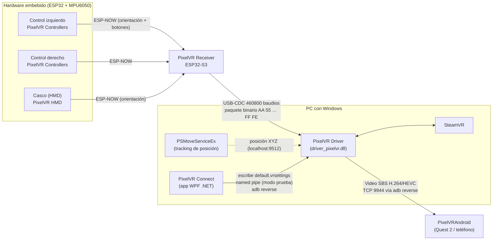

# Pixel VR

**Sistema de realidad virtual de bajo costo para SteamVR**, basado en microcontroladores ESP32, sensores inerciales (IMU MPU6050) y un visor que puede ser un teléfono/Meta Quest 2 (por USB) o un monitor de PC.

Pixel VR permite jugar contenido de SteamVR con un casco (HMD) y dos mandos construidos con hardware económico. Los datos de orientación y botones viajan de forma inalámbrica por ESP-NOW hacia un receptor USB conectado al PC; un *driver* de SteamVR los convierte en dispositivos VR reales, y el video renderizado vuelve al visor mediante un flujo H.264/HEVC por USB.

> Repositorio monolítico ("monorepo"): cada carpeta de primer nivel es un **subproyecto independiente** con su propio lenguaje, herramienta de compilación y dependencias.

---

## Índice

1. [Arquitectura general](#1-arquitectura-general)
2. [Mapa del repositorio](#2-mapa-del-repositorio)
3. [Descripción de cada subproyecto](#3-descripción-de-cada-subproyecto)
   - [3.1 PixelVR Controllers](#31-pixelvr-controllers--firmware-de-los-mandos)
   - [3.2 PixelVR HMD](#32-pixelvr-hmd--firmware-del-casco)
   - [3.3 PixelVR Receiver](#33-pixelvr-receiver--receptor-usb)
   - [3.4 PixelVR Driver](#34-pixelvr-driver--driver-de-steamvr)
   - [3.5 PixelVR Connect](#35-pixelvr-connect--aplicación-de-escritorio)
   - [3.6 PixelVRAndroid](#36-pixelvrandroid--cliente-de-video-openxr)
4. [Protocolos de comunicación](#4-protocolos-de-comunicación)
5. [Dónde están las librerías](#5-dónde-están-las-librerías)
6. [Dónde está el código fuente de lógica](#6-dónde-está-el-código-fuente-de-lógica)
7. [Cómo compilar cada subproyecto](#7-cómo-compilar-cada-subproyecto)
8. [Archivos generados que no son código fuente](#8-archivos-generados-que-no-son-código-fuente)
9. [Observaciones técnicas](#9-observaciones-técnicas)
10. [Licencias](#10-licencias)

---

## 1. Arquitectura general

El sistema se divide en **tres capas**: hardware embebido (ESP32), software del PC (driver + app de configuración) y cliente de visualización (Android/Quest).



### Flujo de datos resumido

| Etapa | Qué ocurre | Dónde |
|---|---|---|
| 1. Captura | Cada IMU MPU6050 se lee a 200 Hz; un filtro Madgwick calcula el cuaternión de orientación. Los mandos además leen botones y joystick. | `PixelVR Controllers`, `PixelVR HMD` |
| 2. Transmisión inalámbrica | Cada dispositivo envía su paquete por **ESP-NOW** (sin router, baja latencia) al receptor. | Mismos firmwares |
| 3. Agregación | El receptor junta los tres orígenes en una sola estructura `allData` y la emite por USB a 200 Hz. | `PixelVR Receiver` |
| 4. Integración en SteamVR | El driver lee el puerto COM, completa la posición con PSMoveServiceEx y expone HMD + 2 mandos a SteamVR. | `PixelVR Driver` |
| 5. Video | El driver compone ambos ojos lado a lado (SBS), lo codifica por GPU y lo envía por TCP al cliente. | `PixelVR Driver` → `PixelVRAndroid` |
| 6. Configuración | Connect edita la configuración del driver, gestiona el túnel ADB y puede simular poses para pruebas. | `PixelVR Connect` |

---

## 2. Mapa del repositorio

```
Pixel-VR/
├── README.md                  ← este documento
├── LICENSE                    (MIT, ALNZ Dev)
├── .gitignore / .gitattributes
│
├── PixelVR Controllers/       Firmware de los mandos        (C++ / PlatformIO, ESP32-S2)
├── PixelVR HMD/               Firmware del casco            (C++ / PlatformIO, ESP32)
├── PixelVR Receiver/          Firmware del receptor USB     (C++ / PlatformIO, ESP32-S3)
├── PixelVR Driver/            Driver de SteamVR para Windows (C++ / CMake, DLL)
├── PixelVR Connect/           App de configuración y pruebas (C# / WPF, .NET 10)
└── PixelVRAndroid/            Cliente de video OpenXR        (Kotlin + C++ NDK, Android)
```

### Tabla comparativa

| Subproyecto | Rol | Lenguaje | Sistema de build | Plataforma destino |
|---|---|---|---|---|
| `PixelVR Controllers` | Mandos: IMU, botones, joystick, háptico | C++ (Arduino) | PlatformIO | ESP32-S2 (`lolin_s2_mini`) |
| `PixelVR HMD` | Casco: IMU de orientación de cabeza | C++ (Arduino) | PlatformIO | ESP32 (`esp32dev`) |
| `PixelVR Receiver` | Puente ESP-NOW → USB | C++ (Arduino) | PlatformIO | ESP32-S3 DevKitC-1 |
| `PixelVR Driver` | Integración con SteamVR y streaming de video | C++17 | CMake / Visual Studio | Windows x64 |
| `PixelVR Connect` | Configuración, pruebas y gestión de ADB | C# (WPF, XAML) | .NET SDK (`net10.0-windows`) | Windows |
| `PixelVRAndroid` | Recibir, decodificar y mostrar el video estéreo | Kotlin + C++ | Gradle + CMake (NDK) | Android arm64 / Meta Quest 2 |

---

## 3. Descripción de cada subproyecto

### 3.1 `PixelVR Controllers` — Firmware de los mandos

**Qué es:** el programa que corre dentro de cada mando (izquierdo y derecho). El mismo código sirve para ambos; la variable `lado` (`1` = izquierdo, `0` = derecho) en `src/main.cpp` define cuál es.

**Qué hace:**
- Lee un **IMU MPU6050** por I²C a 400 kHz y calcula la orientación con el filtro **Madgwick**, con *beta adaptativo* (más corrección de gravedad cuando el mando está quieto) y suavizado **NLERP** del cuaternión.
- Lee 5 botones digitales (`A`, `B`, `system`, `trigger`, `grip`), el clic del joystick y los dos ejes analógicos del **joystick** (ADC de 12 bits, con calibración del centro, zona muerta y curva progresiva).
- Controla un LED RGB (animación de arranque) y un pin de motor háptico (`HAPTIC_PIN`).
- Guarda la calibración del IMU en **EEPROM**.
- Envía un paquete `ControllerData` por **ESP-NOW** al receptor a 200 Hz.
- Acepta comandos por serial (115200 baudios): `calibrate`, `show`, `recenter`, `stick`, `stickraw`, `geo <0-7>`.

| Elemento | Ubicación |
|---|---|
| Código fuente de lógica | `PixelVR Controllers/src/main.cpp` |
| Configuración de compilación y dependencias | `PixelVR Controllers/platformio.ini` |
| Librerías | Descargadas por PlatformIO (ver [sección 5](#5-dónde-están-las-librerías)): `FastIMU` y `Madgwick` |
| Carpetas `include/`, `lib/`, `test/` | Plantillas vacías de PlatformIO (solo contienen un `README`) |

---

### 3.2 `PixelVR HMD` — Firmware del casco

**Qué es:** el firmware del ESP32 montado en el visor. Es una versión simplificada del firmware de los mandos, sin botones ni joystick.

**Qué hace:**
- Lee su propio MPU6050 (pines I²C `SDA=22`, `SCL=21`) y aplica el mismo filtrado Madgwick adaptativo + NLERP.
- Configura el filtro pasa-bajos digital del sensor (DLPF) y guarda la calibración en EEPROM.
- Transforma los ejes del sensor al sistema de coordenadas de SteamVR y envía un paquete `HmdData` por ESP-NOW.
- Comandos serial: `calibrate`, `show`, `recenter` (sin efecto: no hay magnetómetro, por lo que el *yaw* no tiene referencia absoluta) y `geo <0-7>`.

| Elemento | Ubicación |
|---|---|
| Código fuente de lógica | `PixelVR HMD/src/main.cpp` |
| Configuración de compilación | `PixelVR HMD/platformio.ini` (placa `esp32dev`, 921600 baudios de carga) |
| Librería local incluida | `PixelVR HMD/lib/FastIMU-1.3.0/` (copia de la librería FastIMU incluida en el repositorio) |
| Librería externa | `Madgwick` (declarada en `platformio.ini`) |

---

### 3.3 `PixelVR Receiver` — Receptor USB

**Qué es:** un ESP32-S3 conectado por USB al PC. Es el **puente** entre el mundo inalámbrico (ESP-NOW) y el driver.

**Qué hace:**
- Registra un único callback ESP-NOW y distingue el origen de cada paquete por su primer byte (`0x01` = mando, `0x02` = casco), validando además el tamaño esperado.
- Guarda los datos en una estructura unificada `allData` (HMD + mando izquierdo + mando derecho), protegida con una sección crítica (`portMUX`) por concurrencia.
- Emite `allData` por **USB-CDC a 460800 baudios** con un ritmo fijo de **200 Hz**, independiente del momento en que llegue cada paquete inalámbrico.
- No tiene IMU propio: solo reenvía.

| Elemento | Ubicación |
|---|---|
| Código fuente de lógica | `PixelVR Receiver/src/main.cpp` |
| Configuración de compilación | `PixelVR Receiver/platformio.ini` (ESP32-S3, 16 MB de flash, USB-CDC al arrancar) |
| Librerías | Descargadas por PlatformIO: `Madgwick`, `FastIMU` |

---

### 3.4 `PixelVR Driver` — Driver de SteamVR

**Qué es:** una **DLL nativa** (`driver_pixelvr.dll`) que SteamVR carga como driver de dispositivos. Es el núcleo del sistema en el PC: convierte los datos crudos del receptor en un casco y dos mandos reconocidos por SteamVR y, en modo Android, envía el video al visor.

**Qué hace:**
- **Dispositivos virtuales:** registra el HMD y los controles izquierdo y derecho mediante la API **OpenVR**.
- **Entrada de tracking** (dos modos, según `driverMode` en la configuración):
  - `driverNormal`: abre el puerto COM del receptor y decodifica el paquete binario `AA 55 … FF FE`.
  - `driverTest`: lee poses sintéticas desde el *named pipe* `\\.\pipe\PixelVR_Pipe` (las produce PixelVR Connect).
- **Posición XYZ:** se obtiene de **PSMoveServiceEx** (`localhost:9512`); las rotaciones vienen del IMU.
- **Modos de pantalla** (`displayMode`): `monitor`, `android` (visor por USB) y `alvr` (Quest 2 con ALVR; el driver envía solo la pose del HMD por UDP a `127.0.0.1:9945`).
- **Streaming de video (modo Android):** SteamVR renderiza en texturas del driver (*Direct Mode*), el driver compone ambos ojos lado a lado en GPU, los codifica (H.264/HEVC) y los envía por TCP.
- **Codificadores de video:** NVIDIA NVENC, AMD VCN (AMF), Intel QuickSync, Media Foundation (alternativa) y FFmpeg (opcional).
- Define los perfiles de entrada de los mandos (botones, joystick, gatillos) y los íconos que muestra SteamVR.

#### Código fuente (`PixelVR Driver/src/`)

| Archivo(s) | Responsabilidad |
|---|---|
| `driver_factory.cpp` | Punto de entrada de la DLL (`HmdDriverFactory`) que SteamVR invoca |
| `main.cpp` / `main.h` | `MyDeviceProvider`: inicialización, registro de dispositivos, ciclo de frames y limpieza |
| `hmd.cpp` / `hmd.h` | Dispositivo HMD (pose, display, componente Direct Mode) |
| `controllers.cpp` / `controllers.h` | Dispositivos de los mandos y sus componentes de entrada |
| `pipe_handler.cpp` / `.h` | Hilo de entrada: lectura del puerto COM (`SerialLoop`) o del named pipe (`PipeLoop`); estructura `AllData` |
| `psm_tracking_manager.cpp` / `.h` | Cliente de PSMoveServiceEx para la posición de HMD y mandos |
| `config_manager.cpp` / `.h` | Lectura de `default.vrsettings` (sección `driver_pixelvr`) |
| `direct_mode.cpp` / `.h` | `IVRDriverDirectModeComponent`: recibe las texturas de cada ojo desde el compositor |
| `sbs_composer.cpp` / `.h` | Composición *side-by-side* (izquierda \| derecha) en GPU con Direct3D 11 |
| `video_stream_pipeline.cpp` / `.h` | Hilo de codificación y envío; descarta frames viejos para acotar la latencia |
| `streaming_server.cpp` / `.h` | Servidor TCP (Winsock) que atiende al cliente Android |
| `stream_protocol.h` | Definición del protocolo de video `PVRF` (cabecera de 44 bytes) |
| `video_encoder.h` | Interfaz abstracta `IStreamVideoEncoder` |
| `encoders/` | Implementaciones: `video_encoder_nvidia`, `_amd`, `_intel`, `_mf`, `ffmpeg_video_encoder` y `video_encoder_factory` |
| `alvr_pose_bridge.cpp` / `.h` | Envío de la pose del HMD a ALVR por UDP |
| `d3d11_helper.cpp` / `.h`, `display_mode.cpp` / `.h` | Utilidades de Direct3D 11 / DXGI y detección de monitores |
| `driverlog.cpp` / `.h`, `vrmath.h` | Registro de eventos y funciones matemáticas |
| `frame_capture.cpp` / `.h` | Captura de escritorio por DXGI. **No está incluido en `CMakeLists.txt`**, por lo que no se compila actualmente |

#### Recursos del driver (`PixelVR Driver/pixelvr/`)

Carpeta que se copia tal cual a la instalación de SteamVR:

| Ruta | Contenido |
|---|---|
| `driver.vrdrivermanifest` | Manifiesto: nombre del driver, perfiles de mandos e íconos |
| `resources/input/left/`, `resources/input/right/` | Perfiles de entrada, *bindings* y remapeos de cada mando (JSON) |
| `resources/settings/default.vrsettings` | **Configuración principal del driver** (puerto COM, modo, streaming, FOV, IPD, etc.) |
| `resources/icons/`, `resources/rendermodels/`, `resources/localization/` | Íconos, modelos 3D y textos |
| `bin/win64/` | Binarios ya compilados: `driver_pixelvr.dll` y sus DLL de apoyo (PSMoveClient y FFmpeg) |

| Elemento | Ubicación |
|---|---|
| Definición del build | `PixelVR Driver/CMakeLists.txt` |
| Solución de Visual Studio | `PixelVR Driver/pixelvr.slnx` y `driver_pixelvr.vcxproj` (generados por CMake) |
| Librerías | `PixelVR Driver/lib/` (ver [sección 5](#5-dónde-están-las-librerías)) |

---

### 3.5 `PixelVR Connect` — Aplicación de escritorio

**Qué es:** una aplicación de Windows (WPF, .NET 10, interfaz Material Design) para **configurar el driver** y probar el sistema sin necesidad de abrir SteamVR con el hardware completo.

**Qué hace:**
- Lista los puertos COM, guarda el del receptor y deja el driver en `driverNormal` (Connect no necesita seguir abierto para que el tracking funcione).
- **Driver Test:** cambia temporalmente `driverMode` a `driverTest` y envía poses sintéticas del HMD y los dos mandos por el named pipe `PixelVR_Pipe`.
- Gestiona **ADB**: detecta dispositivos Android y crea el túnel `adb reverse tcp:9944 tcp:9944`.
- Lee y escribe `default.vrsettings` (resolución, FOV, IPD, bitrate, códec, modo de pantalla, etc.).
- Soporta el modo **Meta Quest 2 (ALVR) + tracking PixelVR**.
- Inicia y cierra SteamVR (`steam://rungameid/250820`).

| Archivo | Responsabilidad |
|---|---|
| `MainWindow.xaml` / `MainWindow.xaml.cs` | Interfaz de usuario y lógica principal (≈1450 líneas cada uno) |
| `USBCDCManager.cs` | Lectura del puerto serie del receptor, reconexión automática y estadísticas |
| `PipeManager.cs` | Servidor de *named pipe* para las poses sintéticas del modo de prueba |
| `DriverSettingsManager.cs` | Lectura/escritura del JSON `default.vrsettings` |
| `AdbManager.cs` | Ejecución de comandos `adb` (dispositivos, `reverse`, limpieza) |
| `SensorDataProcessor.cs` | Matemática de cuaterniones y ángulos de Euler |
| `App.xaml`, `App.xaml.cs`, `AssemblyInfo.cs` | Arranque de la aplicación WPF |
| `PixelVR Connect.csproj` / `.slnx` | Proyecto y solución de .NET |
| `sources/images/`, archivos `.png` en la raíz | Recursos gráficos de la interfaz |

| Elemento | Ubicación |
|---|---|
| Librerías | Paquetes NuGet declarados en `PixelVR Connect.csproj` (ver [sección 5](#5-dónde-están-las-librerías)) |
| Documentación propia | `PixelVR Connect/README.md` |

---

### 3.6 `PixelVRAndroid` — Cliente de video OpenXR

**Qué es:** una aplicación Android (probada con **Meta Quest 2**) que recibe el video estéreo SBS del driver y lo muestra en modo inmersivo con **OpenXR**.

**Qué hace:**
- Se conecta como **cliente TCP** a `127.0.0.1:9944` (el túnel `adb reverse` lo lleva hasta el PC), sin depender de Wi-Fi.
- Reconstruye cada paquete `PVRF`, decodifica H.264/HEVC con `MediaCodec` y dibuja cada mitad del cuadro en el ojo correspondiente.
- Usa el FOV de origen (enviado por el driver) junto con el FOV real de cada ojo de OpenXR para remapear la imagen sin deformaciones; las zonas sin cobertura quedan negras.
- **No envía** poses ni entradas al driver: el tracking sigue viniendo de los ESP32.

| Archivo | Responsabilidad |
|---|---|
| `app/src/main/java/com/pixelvr/pixelvrandroid/MainActivity.kt` | Actividad principal y ciclo de vida |
| `StreamReceiver.kt` | Conexión TCP y lectura del flujo; reconexión si el decodificador se atasca |
| `PacketParser.kt` | Interpretación de la cabecera `PVRF` |
| `VideoDecoder.kt` | Decodificación con `MediaCodec` (baja latencia en API 30+) |
| `StereoRenderer.kt` | Dibujo OpenGL ES de cada ojo |
| `StreamFov.kt` | Almacena FOV y frecuencia del stream |
| `OpenXrSession.kt` | Interfaz JNI hacia el código nativo |
| `app/src/main/cpp/openxr_session.cpp` | Sesión OpenXR nativa (swapchains, composición, ≈830 líneas) |
| `app/src/main/cpp/CMakeLists.txt` | Compila la librería nativa `pixelvr_openxr` |
| `app/build.gradle.kts` | Configuración Gradle (SDK 34, mínimo 24, solo `arm64-v8a`) |
| `app/src/main/AndroidManifest.xml` | Declara la app como OpenXR inmersiva de Quest |

| Elemento | Ubicación |
|---|---|
| Librerías | Gradle: `org.khronos.openxr:openxr_loader_for_android:1.1.65` |
| Documentación propia | `PixelVRAndroid/README.md` |

---

## 4. Protocolos de comunicación

| Enlace | Medio | Formato |
|---|---|---|
| Mandos / HMD → Receptor | ESP-NOW (2.4 GHz, sin cifrado, canal automático) | Estructuras C empaquetadas (`__attribute__((packed))`). El primer byte indica el tipo: `0x01` = `ControllerData`, `0x02` = `HmdData` |
| Receptor → Driver | USB-CDC, 460800 baudios, 200 Hz | `AA 55` + estructura binaria `allData` + `FF FE` |
| Connect → Driver (pruebas) | Named pipe `\\.\pipe\PixelVR_Pipe` | Estructura `AllData` con poses sintéticas |
| Driver → ALVR | UDP `127.0.0.1:9945` | Pose del HMD de SteamVR |
| Driver → PSMoveServiceEx | `localhost:9512` | API cliente `PSMoveClient_CAPI` |
| Driver → Android | TCP `9944` (túnel `adb reverse`) | Cabecera `PVRF` de 44 bytes (little-endian) + payload H.264/HEVC Annex-B |
| Connect → Driver (configuración) | Archivo `default.vrsettings` (JSON) | Sección `driver_pixelvr` |

**Cabecera de video `PVRF`** (definida en `PixelVR Driver/src/stream_protocol.h`): `magic`, `frameId`, `timestampUs`, `width`, `height`, `codec`, `flags` (keyframe), `framerate`, `payloadBytes` y los cuatro ángulos de FOV de origen.

---

## 5. Dónde están las librerías

Cada subproyecto gestiona sus dependencias de forma distinta.

### Firmwares ESP32 (PlatformIO)

| Subproyecto | Librerías | Origen |
|---|---|---|
| `PixelVR Controllers` | `FastIMU` (lectura de IMU), `Madgwick` ≥ 1.2.0 | Declaradas en `platformio.ini` (`lib_deps`); PlatformIO las descarga automáticamente al compilar. `FastIMU` viene de GitHub (LiquidCGS) |
| `PixelVR HMD` | `FastIMU` 1.3.0 | **Incluida en el repositorio:** `PixelVR HMD/lib/FastIMU-1.3.0/` |
| | `Madgwick` ≥ 1.2.0 | Declarada en `platformio.ini` |
| `PixelVR Receiver` | `Madgwick`, `FastIMU` | Declaradas en `platformio.ini` |

Además, todos usan las librerías del núcleo Arduino-ESP32 (`WiFi`, `esp_now`, `Wire`, `EEPROM`), incluidas en la plataforma `espressif32`.

### Driver de SteamVR (`PixelVR Driver/lib/`)

| Carpeta | Librería | Uso |
|---|---|---|
| `lib/openvr/` | **OpenVR SDK** de Valve (cabeceras en `headers/`, binarios en `lib/win64/`, etc.) | API para escribir el driver de SteamVR |
| `lib/PSMoveClient_CAPI/` | Cliente de **PSMoveServiceEx** (`include/`, `lib/`, `bin/`) | Posición XYZ de casco y mandos |
| `lib/AMF/` | **AMD AMF SDK** (cabeceras `core/` y `components/`) | Codificación por hardware en GPU AMD (las DLL se cargan en tiempo de ejecución) |
| `lib/ffmpeg/` | **FFmpeg** (SDK compartido, *opcional*) | Codificadores FFmpeg. Está en `.gitignore`: hay que copiarla manualmente antes de configurar CMake. Sus DLL de ejecución ya están en `pixelvr/bin/win64/` |

Librerías del sistema Windows enlazadas desde `CMakeLists.txt`: `d3d11`, `dxgi`, `dxguid`, `d3dcompiler`, `ws2_32`, `mfplat`, `mf`, `mfuuid`, `strmiids`, `ole32`.

Los SDK de NVIDIA NVENC e Intel oneVPL están **comentados** en `CMakeLists.txt` (opcionales).

### PixelVR Connect (NuGet)

Declaradas en `PixelVR Connect/PixelVR Connect.csproj`:

| Paquete | Versión | Uso |
|---|---|---|
| `MaterialDesignThemes` / `MaterialDesignColors` | 5.3.2 | Estilo visual de la interfaz |
| `System.IO.Ports` | 10.0.12 | Comunicación con el puerto serie del receptor |
| `System.Management` | 10.0.12 | Consultas de sistema (WMI) |

### PixelVRAndroid (Gradle)

Declarada en `PixelVRAndroid/app/build.gradle.kts`: `org.khronos.openxr:openxr_loader_for_android:1.1.65`. Se enlaza a la librería nativa mediante `find_package(OpenXR)` en `app/src/main/cpp/CMakeLists.txt`, junto con las librerías del NDK (`android`, `log`, `EGL`, `GLESv3`).

---

## 6. Dónde está el código fuente de lógica

| Qué quiero ver | Archivo |
|---|---|
| Lectura del IMU, filtro Madgwick, botones y joystick de los mandos | `PixelVR Controllers/src/main.cpp` |
| Orientación del casco y envío ESP-NOW | `PixelVR HMD/src/main.cpp` |
| Unión de los tres orígenes y salida USB | `PixelVR Receiver/src/main.cpp` |
| Punto de entrada del driver | `PixelVR Driver/src/driver_factory.cpp`, `main.cpp` |
| Lectura del puerto COM y named pipe | `PixelVR Driver/src/pipe_handler.cpp` |
| Representación del HMD y de los mandos en SteamVR | `PixelVR Driver/src/hmd.cpp`, `controllers.cpp` |
| Composición estéreo y codificación de video | `PixelVR Driver/src/direct_mode.cpp`, `sbs_composer.cpp`, `video_stream_pipeline.cpp`, `src/encoders/` |
| Servidor TCP y protocolo de video | `PixelVR Driver/src/streaming_server.cpp`, `stream_protocol.h` |
| Configuración del driver | `PixelVR Driver/src/config_manager.cpp` y `pixelvr/resources/settings/default.vrsettings` |
| Perfiles de entrada de los mandos | `PixelVR Driver/pixelvr/resources/input/` |
| Interfaz y lógica de la app de escritorio | `PixelVR Connect/MainWindow.xaml(.cs)` y los `*Manager.cs` |
| Cliente de video Android | `PixelVRAndroid/app/src/main/java/com/pixelvr/pixelvrandroid/*.kt` |
| Sesión OpenXR nativa | `PixelVRAndroid/app/src/main/cpp/openxr_session.cpp` |

---

## 7. Cómo compilar cada subproyecto

> Los pasos siguientes se derivan de los archivos de configuración de cada proyecto.

### Firmwares ESP32
Requisitos: [PlatformIO](https://platformio.org/) (extensión de VS Code o CLI).

```bash
cd "PixelVR Receiver"      # o "PixelVR HMD" / "PixelVR Controllers"
pio run                    # compilar
pio run -t upload          # cargar a la placa
pio device monitor         # monitor serie
```

Antes de cargar los firmwares de **HMD** y **Controllers**, es necesario poner en la variable `mac[6]` de su `src/main.cpp` la **dirección MAC del receptor** (el receptor la imprime por serial al iniciar). En los mandos, además, hay que ajustar `lado` (`1` = izquierdo, `0` = derecho) antes de cargar cada uno.

### Driver de SteamVR
Requisitos: Windows, CMake ≥ 3.10 y Visual Studio con herramientas de C++.

```bash
cd "PixelVR Driver"
cmake -B build -A x64
cmake --build build --config Release
```

El resultado es `driver_pixelvr.dll`. La carpeta `pixelvr/` (manifiesto, recursos y `bin/win64/`) debe registrarse en SteamVR como driver.

### PixelVR Connect
Requisitos: Windows y .NET SDK 10.

```bash
cd "PixelVR Connect"
dotnet build -c Release
```

### PixelVRAndroid
Requisitos: Android Studio, JDK 17+, Android SDK Platform 34, NDK y CMake. Abrir la carpeta `PixelVRAndroid` en Android Studio y elegir **Build → Build APK(s)**. Los detalles de conexión por USB están en `PixelVRAndroid/README.md`.

---

## 8. Archivos generados que no son código fuente

Algunas carpetas del repositorio contienen **resultados de compilación**. No hace falta leerlas para entender el proyecto:

| Carpeta | Contenido generado |
|---|---|
| `PixelVR Driver/CMakeFiles/`, `CMakeCache.txt`, `cmake_install.cmake` | Caché y archivos intermedios de CMake |
| `PixelVR Driver/*.vcxproj`, `*.filters`, `*.user` | Proyectos de Visual Studio generados por CMake |
| `PixelVR Driver/x64/`, `Release/`, `driver_pixelvr.dir/` | Salida intermedia de MSBuild |
| `PixelVR Driver/pixelvr/bin/win64/` | DLL ya compiladas (driver y dependencias) |
| `PixelVR Connect/bin/`, `obj/` | Ejecutable y archivos intermedios de .NET |

---

## 9. Observaciones técnicas

Detalles detectados al analizar el código, útiles para documentar el estado real del proyecto:

- **Ruta fija en Connect:** `PixelVR Connect/MainWindow.xaml.cs` (línea 34) define `DriverSettingsPath` con una ruta absoluta del equipo del autor (`C:\Users\gabum\Desktop\Pixel-VR\...\default.vrsettings`). Para usar la aplicación en otro equipo hay que cambiarla.
- **Valores personales en `default.vrsettings`:** el archivo incluido trae datos del equipo del autor (puerto `COM5`, ruta de `adb` y número de serie del dispositivo Android). Deben ajustarse en cada instalación.
- **Nombre de entorno en Controllers:** en `PixelVR Controllers/platformio.ini` el entorno se llama `esp32-s3-devkitc-1`, pero la placa configurada es `lolin_s2_mini` (ESP32-S2). Es solo el nombre; la placa efectiva es la ESP32-S2.
- **MAC del receptor repetida:** la dirección MAC está escrita directamente en el código de HMD y Controllers; si se cambia el receptor hay que recompilar ambos.
- **Sin cifrado ESP-NOW:** se desactiva deliberadamente para priorizar la latencia (`peerInfo.encrypt = false`).
- **Sin magnetómetro:** el *yaw* (giro horizontal) no tiene referencia absoluta y puede derivar con el tiempo; por eso la posición se complementa con PSMoveServiceEx y los mandos tienen comando `recenter`.
- **Dependencia externa:** la posición espacial requiere **PSMoveServiceEx** ejecutándose en el PC. Si no está disponible, el driver continúa sin él (solo orientación).
- **Plataforma:** el driver y Connect son exclusivos de Windows (Direct3D 11, Winsock, named pipes, Media Foundation).

---

## 10. Licencias

| Componente | Licencia |
|---|---|
| Repositorio general (`LICENSE`) | MIT — © 2026 ALNZ Dev |
| `PixelVR Controllers`, `PixelVR HMD`, `PixelVR Receiver` | MIT — © 2026 Gabriel Montenegro Kubiza (cada carpeta incluye su `LICENSE`) |
| `PixelVR Connect` | MIT — © 2026 Gabriel Montenegro Kubiza (`LICENSE.txt`) |
| `PixelVR Driver` | BSD 3-Clause — © 2026 Gabriel Montenegro Kubiza (`LICENSE.txt`) |
| Librerías de terceros (OpenVR, PSMoveClient, AMF, FastIMU, FFmpeg, OpenXR) | Cada una conserva su propia licencia dentro de su carpeta |
